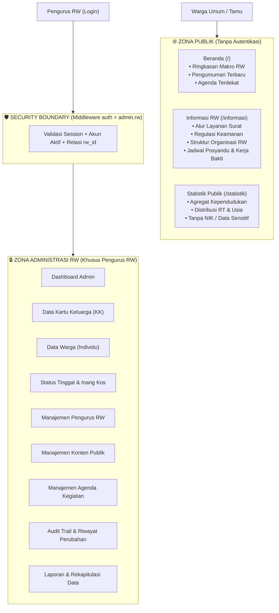
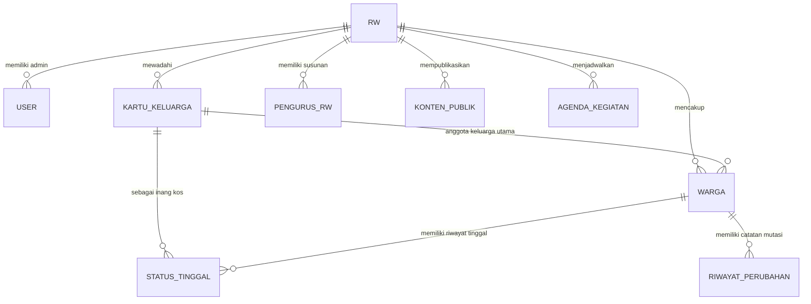
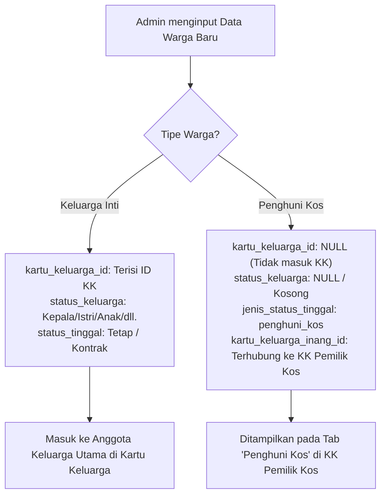
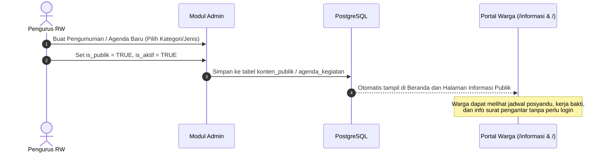

# Arsitektur, Fitur, dan Bisnis Proses Platform WargaIn

Dokumen ini memetakan seluruh sistem **WargaIn** (Sistem Informasi Pendataan & Administrasi Warga Tingkat RW) yang sedang berjalan saat ini, mencakup arsitektur boundary, entitas data, alur bisnis proses, serta aturan logika kependudukan.

---

## 1. Arsitektur Boundary (Pemisahan Publik vs Privat)

WargaIn dirancang dengan batasan privasi data yang ketat (*Privacy by Design*):

---

## 2. Entitas Data Utama & Relasinya

### Detail Entitas:
1. **`RW`**: Basis wilayah otonom (kode RW, nama RW, kelurahan, kecamatan, kota, provinsi, alamat sekretariat).
2. **`Users`**: Akun login pengurus (`admin_rw`, `super_admin`) yang terikat ke `rw_id`.
3. **`KartuKeluarga`**: Entitas kartu keluarga dengan nomor KK 16 digit, RT/RW, status rumah (milik/sewa/kontrak), dan penetapan kepala keluarga.
4. **`Warga`**: Entitas individu warga (NIK 16 digit, nama lengkap, gender, tempat/tgl lahir, agama, pekerjaan, pendidikan, status keluarga).
5. **`StatusTinggal`**: Status kependudukan aktif dan historis (Tetap, Kontrak, Kos, Pendatang, Sementara, Penghuni Kos).
6. **`PengurusRw`**: Daftar pejabat RW (Ketua, Sekretaris, Bendahara, Seksi Keamanan, Karang Taruna).
7. **`KontenPublik`**: Informasi publik berkategori (Pengumuman, Layanan Surat, Keamanan Lingkungan, Informasi Umum).
8. **`AgendaKegiatan`**: Jadwal kegiatan (Posyandu balita/lansia, Kerja Bakti, Rapat Pengurus).
9. **`RiwayatPerubahan`**: Catatan mutasi (Lahir, Meninggal, Pindah Masuk, Pindah Keluar, Perubahan Data KK).

---

## 3. Alur Bisnis Proses (Proses Inti)

### A. Pendataan Warga Inti vs Penghuni Kos (Revisi Logika Kependudukan)

Salah satu keunggulan logika WargaIn saat ini adalah **pemisahan anggota KK kandung dengan warga kos**:

**Tujuan Aturan Ini:**
- Menghindari manipulasi data sensus (anak kos tidak boleh tercatat sebagai anggota keluarga sah dari pemilik kos).
- Memastikan pemilik kos tetap bertanggung jawab secara administratif atas data penyewa yang tinggal di lingkungannya.
- Statistik agregat RW dapat membedakan secara presisi antara warga ber-KTP setempat vs pendatang kos.

---

### B. Alur Publikasi Informasi & Agenda RW

---

### C. Alur Mutasi & Audit Trail Kependudukan

Setiap ada mutasi kependudukan (contoh: warga meninggal dunia atau pindah domisili keluar):
1. **Pembaruan Status Warga**: Status warga diubah (`status_hidup = meninggal` atau `is_aktif = false`).
2. **Pencatatan Status Tinggal**: Record pada `status_tinggal` diberi `tanggal_keluar` dan `status_aktif = false`.
3. **Perekaman Audit Trail**: Sistem menulis log ke `riwayat_perubahan` (`data_lama` vs `data_baru`) lengkap dengan identitas admin yang mengeksekusi dan alasan mutasi.
4. **Otomasi Kepala Keluarga**: Jika warga yang meninggal/pindah adalah Kepala Keluarga pada KK terkait, sistem meminta penunjukan Kepala Keluarga pengganti.

---

## 4. Matriks Fitur Lengkap Saat Ini

| Modul | Halaman / Endpoint | Hak Akses | Fitur & Fungsi |
|---|---|---|---|
| **Beranda Publik** | `/` | Publik (Bebas) | Profil RW, kartu statistik makro (KK, Warga, RT, Kos), 3 pengumuman terbaru, 3 agenda terdekat. |
| **Informasi RW** | `/informasi` | Publik (Bebas) | Kategori konten (Layanan, Keamanan, Pengumuman), agenda per jenis (Posyandu, Kerja Bakti, Rapat), bagan struktur RW. |
| **Statistik Publik** | `/statistik` | Publik (Bebas) | Distribusi KK per RT, piramida kelompok usia, proporsi status tinggal, statistik pendidikan & pekerjaan. *(Aman tanpa PII)*. |
| **Autentikasi** | `/login`, `/logout` | Publik / User | Login ganda via email atau username, verifikasi admin RW, session guard. |
| **Dashboard** | `/dashboard` | Admin RW | Monitoring angka kependudukan real-time, statistik internal, navigasi cepat ke pendataan. |
| **Kartu Keluarga** | `/kartu-keluarga` | Admin RW | Daftar KK (pencarian nomor KK / kepala), tambah KK, edit data alamat, detail KK (tab anggota utama & tab penghuni kos). |
| **Data Warga** | `/warga` | Admin RW | Registrasi warga baru, filter pencarian NIK & nama, status disabilitas, detail profil lengkap, histori tempat tinggal. |
| **Status Tinggal** | `/status-tinggal` | Admin RW | Mutasi tanggal mulai/keluar tinggal, pemetaan warga ke KK inang kos, filter riwayat aktif/non-aktif. |
| **Konten Publik** | `/konten-publik` | Admin RW | CRUD pengumuman, panduan surat pengantar, regulasi keamanan jam malam, pengaturan urutan & tanggal terbit. |
| **Agenda RW** | `/agenda-kegiatan` | Admin RW | CRUD kegiatan (posyandu, kerja bakti, rapat pleno), jam mulai/selesai, lokasi kegiatan, visibilitas publik. |
| **Pengurus RW** | `/pengurus-rw` | Admin RW | CRUD nama pengurus, jabatan, nomor telepon kontak resmi, urutan hierarki bagan organisasi. |
| **Riwayat Perubahan** | `/riwayat-perubahan` | Admin RW | Audit log mutasi data kependudukan (siapa mengubah apa, kapan, dan nilai sebelum vs sesudah). |
| **Laporan** | `/laporan` | Admin RW | Rekapitulasi agregat administrasi kependudukan untuk pelaporan ke tingkat Kelurahan / Kecamatan. |
