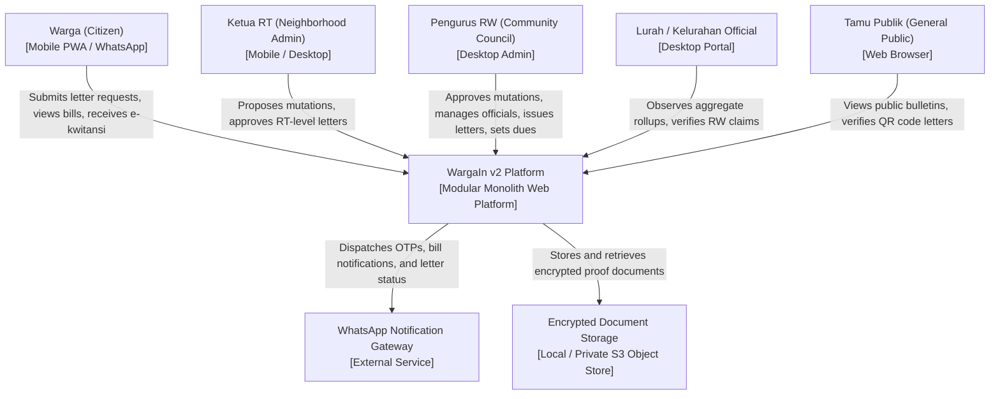
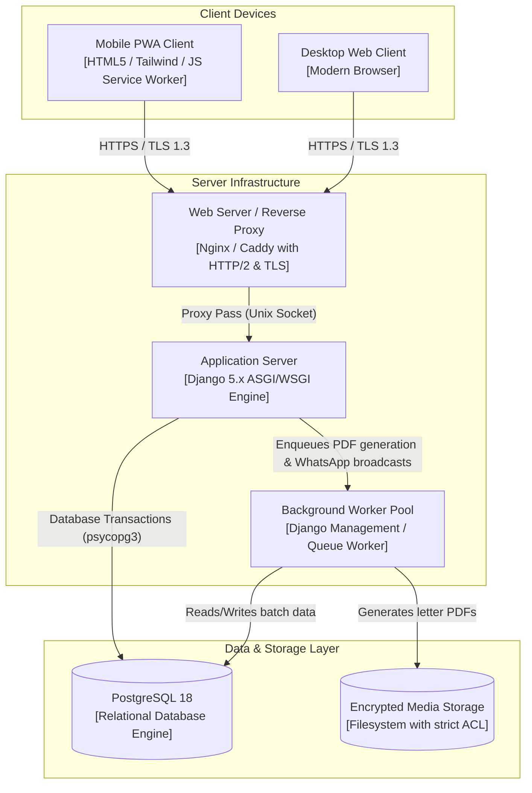
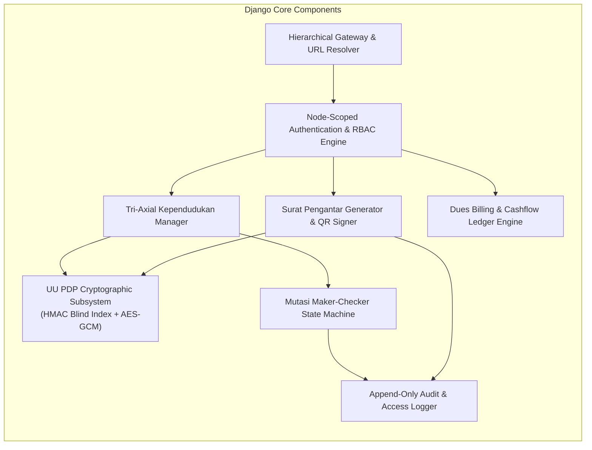

# WargaIn v2 — System Architecture Specification

**Document Identifier:** `DOC-WARGAIN-01-ARCH`  
**Standard Compliance:** ISO/IEC/IEEE 42010:2011 (Systems and software engineering — Architecture description) & C4 Model  
**Author:** Zyntaxera Engineering (@Icun)  
**Classification:** Technical Architecture  
**Release Version:** 2.0.0-PROD-SPEC  

---

## 1. High-Level Architectural Style

WargaIn v2 is architected as a **Modular Monolith** organized into strictly separated domain applications, operating atop a unified multi-tenant relational database (PostgreSQL) with Row-Level Security (RLS) and scoped tree partitions.

```
+-------------------------------------------------------------------------------+
|                            PRESENTATION TIER                                  |
|   Responsive PWA (Mobile Safari / Chrome) & Desktop Web (Tailwind CSS v4)    |
+-------------------------------------------------------------------------------+
                                      |  HTTP/HTTPS (TLS 1.3)
+-------------------------------------------------------------------------------+
|                          GATEWAY & ROUTING TIER                               |
|   Hierarchical URL Parser: /wargain/{prov}/{kota}/{kec}/{kel}/{rw}/{rt}       |
|   Node Scope Extraction -> Tenant Isolation Context Injection                 |
+-------------------------------------------------------------------------------+
                                      |
+-------------------------------------------------------------------------------+
|                           MODULAR APPLICATION TIER                            |
|  +-------------------+  +--------------------+  +-------------------------+  |
|  |   apps.wilayah    |  | apps.kependudukan  |  |       apps.mutasi       |  |
|  |  (Tree & Claims)  |  | (Tri-Axial Domain) |  |     (Maker-Checker)     |  |
|  +-------------------+  +--------------------+  +-------------------------+  |
|  +-------------------+  +--------------------+  +-------------------------+  |
|  |   apps.layanan    |  |    apps.portal     |  |       apps.audit        |  |
|  | (Surat & Billing) |  |   (Public Views)   |  |   (Immutable Logs)      |  |
|  +-------------------+  +--------------------+  +-------------------------+  |
+-------------------------------------------------------------------------------+
                                      |  Database Transactions / Connection Pooling
+-------------------------------------------------------------------------------+
|                              DATA STORAGE TIER                                |
|   PostgreSQL 18: Relational Schemas, Column Encryption (AES-GCM),             |
|   HMAC Blind Indexes, Row-Level Security (RLS), Scoped B-Tree Indexes         |
+-------------------------------------------------------------------------------+
```

---

## 2. C4 Model Diagrams

### 2.1 C4 Level 1: System Context Diagram



---

### 2.2 C4 Level 2: Container Architecture



---

### 2.3 C4 Level 3: Component Architecture (Within Django Core)



---

## 3. Hierarchical National Tree Architecture

### 3.1 Tree Structure & Node Relationships
Every administrative entity is a node within an inverted poly-hierarchical tree:

```
[LEVEL 1] PROVINSI (e.g. 32 - Jawa Barat)
   └── [LEVEL 2] KOTA_KABUPATEN (e.g. 32.76 - Kota Depok)
          └── [LEVEL 3] KECAMATAN (e.g. 32.76.08 - Cilodong)
                 └── [LEVEL 4] KELURAHAN_DESA (e.g. 32.76.08.1001 - Sukamaju)
                        └── [LEVEL 5] RW (e.g. RW 001 - Provisioned via Claim)
                               └── [LEVEL 6] RT (e.g. RT 001, RT 002, RT 003)
                                      └── HUNIAN (Building Units A1..Z99)
```

### 3.2 URL Hierarchy Mapping
The URL slug structure directly reflects the territorial hierarchy:
- **Public RW Portal:** `/wargain/jawa-barat/kota-depok/cilodong/sukamaju/rw-001/`
- **Public RT View:** `/wargain/jawa-barat/kota-depok/cilodong/sukamaju/rw-001/rt-002/`
- **Public QR Letter Verification:** `/verifikasi-surat/{kode_verifikasi}/`
- **Scoped Admin Workspace:** `/admin/workspace/{node_id}/`

### 3.3 Strict Tenant Isolation via Scoped Context
When a request enters the application:
1. The routing middleware resolves `{node_id}` or the hierarchical slug.
2. The user's active session is queried against `peran_pengguna` to ensure they hold an active assignment for that specific node or a superior authority.
3. Every ORM query automatically injects the tenant filter:
   ```python
   # Enforced in Model Managers:
   queryset = queryset.filter(rw_id=active_node.id)
   ```
4. Attempts to query or mutate an entity outside the authenticated node trigger an immediate `403 Forbidden` response and an entry in `LogAudit`.

---

## 4. Aggregate Rollup Strategy (Zero-PII Upward Propagation)

To comply with privacy mandates, municipal tiers (Kelurahan, Kecamatan, Kota, Provinsi) **never execute queries against raw `warga` or `kartu_keluarga` tables**.

```
[Level 5: RW] Raw Records (Encrypted NIK, names, addresses)
      │
      ▼  Scheduled Rollup Worker (Nightly / Post-Mutation Trigger)
[Tabel: ringkasan_agregat]
├── node_id: RW 001
├── metrik: total_warga_hidup -> 1,240
├── metrik: total_kk_aktif -> 380
├── metrik: distribusi_usia_balita -> 112
└── metrik: distribusi_pekerjaan_swasta -> 450
      │
      ▼  Mathematical Summation (Rollup)
[Level 4: Kelurahan] Reads ONLY ringkasan_agregat records.
```

If an aggregate slice has fewer than 5 individuals ($N < 5$), it is subjected to **Small-Cell Suppression** (`<5` or merged into an `Lainnya` category) before rendering on public or municipal dashboards.
