# WargaIn v2 — Entity Relationship Diagram & Data Dictionary
**Document Identifier:** DOC-SPEC-02-ERD-DD  
**Standard Compliance:** ISO/IEC 11179 (Metadata Registry) & ISO/IEC 19773  
**Status:** Approved for Implementation  
**Data Privacy Classification:** Confined under UU No. 27/2022 (Indonesian Personal Data Protection Act)

---

## 1. Executive Summary & Conceptual Model

WargaIn v2 decouples relational citizen data from monolithic legacy tables through a **Tri-Axial Separation of Concerns**:
1. **Axis 1: Person (Siapa - Entitas Biologis)**: `IdentitasOrang` (Zero-Knowledge Blind Index) $\rightarrow$ `Warga` (Tenant-scoped encrypted profile).
2. **Axis 2: Family Record (Tercatat di mana - Entitas Dokumen Catatan Sipil)**: `KartuKeluarga` $\rightarrow$ `KeanggotaanKK`.
3. **Axis 3: Domicile / Dwelling (Tinggal di mana - Entitas Fisik & Posisi Wilayah)**: `Hunian` (Anchored to RT) $\rightarrow$ `Domisili` (Temporal occupancy relationship).

This triad ensures that an individual who rents a boarding room (kos/kontrak) in RT 05 but possesses an ID card (KTP) registered in another city or RT 02 is properly accounted for in local public safety, waste management, and census rolls without falsifying civil registry records or producing duplicate primary citizen rows.

---

## 2. Complete Entity Relationship Diagram (ERD)

```mermaid
erDiagram
    WILAYAH_NODE ||--o{ WILAYAH_NODE : "parent_id"
    WILAYAH_NODE ||--o{ WARGA : "scoped_rw_id"
    WILAYAH_NODE ||--o{ HUNIAN : "scoped_rt_id"
    WILAYAH_NODE ||--o{ POS_IURAN : "scoped_node_id"

    IDENTITAS_ORANG ||--o{ WARGA : "identitas_id"
    
    WARGA ||--o{ KEANGGOTAAN_KK : "warga_id"
    KARTU_KELUARGA ||--o{ KEANGGOTAAN_KK : "kartu_keluarga_id"
    
    WARGA ||--o{ DOMISILI : "warga_id"
    HUNIAN ||--o{ DOMISILI : "hunian_id"

    WARGA ||--o{ MUTASI : "warga_id"
    WILAYAH_NODE ||--o{ MUTASI : "target_node_id"

    WARGA ||--o{ SURAT_PENGANTAR : "pemohon_warga_id"
    SURAT_PENGANTAR ||--o{ VERIFIKASI_SURAT_LOG : "surat_id"

    HUNIAN ||--o{ TAGIHAN_IURAN : "hunian_id"
    POS_IURAN ||--o{ TAGIHAN_IURAN : "pos_iuran_id"
    TAGIHAN_IURAN ||--o{ PEMBAYARAN_IURAN : "tagihan_id"

    WILAYAH_NODE {
        uuid id PK
        uuid parent_id FK
        string level "PROVINSI, KOTA, KECAMATAN, KELURAHAN, RW, RT"
        string kode_pos "6 chars"
        string kode_wilayah "BPS/Kemendagri code"
        string nama "e.g. RW 007, RT 003"
        jsonb metadata "Contact, boundaries, stats"
        timestamp created_at
        timestamp updated_at
    }

    IDENTITAS_ORANG {
        uuid id PK
        string nik_blind_index UK "HMAC-SHA256 hex string"
        timestamp created_at
    }

    WARGA {
        uuid id PK
        uuid identitas_id FK
        uuid rw_id FK
        bytea nik_encrypted "AES-256-GCM ciphertext"
        string nik_masked "e.g. 3273********0001"
        string nama_lengkap "Max 150 chars"
        string tempat_lahir
        date tanggal_lahir
        string jenis_kelamin "L / P"
        string agama "ISLAM, KRISTEN, KATOLIK, HINDU, BUDDHA, KONGHUCU"
        string status_perkawinan "BELUM_KAWIN, KAWIN, CERAI_HIDUP, CERAI_MATI"
        string pekerjaan
        string status_keberadaan "AKTIF, MUTASI_KELUAR, MENINGGAL, DIARSIPKAN"
        string nomor_telepon
        string email
        timestamp created_at
        timestamp updated_at
    }

    KARTU_KELUARGA {
        uuid id PK
        uuid rw_id FK
        bytea nomor_kk_encrypted "AES-256-GCM ciphertext"
        string nomor_kk_masked "e.g. 3273********0005"
        string alamat_kk "Sesuai cetakan blanko Dukcapil"
        timestamp created_at
        timestamp updated_at
    }

    KEANGGOTAAN_KK {
        uuid id PK
        uuid kartu_keluarga_id FK
        uuid warga_id FK
        string status_hubungan "KEPALA_KELUARGA, SUAMI, ISTRI, ANAK, MENANTU, CUCU, ORANGTUA, MERTUA, FAMILI_LAIN, PEMBANTU, LAINNYA"
        date tanggal_bergabung
        timestamp created_at
    }

    HUNIAN {
        uuid id PK
        uuid rt_id FK
        string nomor_rumah "e.g. No. 14A, Blok B3/12"
        string alamat_lengkap
        string status_kepemilikan "MILIK_SENDIRI, SEWA_KONTRAK, KOS, DINAS, MENUMPANG"
        jsonb koordinat "lat, lng"
        timestamp created_at
        timestamp updated_at
    }

    DOMISILI {
        uuid id PK
        uuid hunian_id FK
        uuid warga_id FK
        string peran_di_hunian "KEPALA_RUMAH_TANGGA, ANGGOTA, PENYEWA_UTAMA, PENGHUNI_KOS"
        date tanggal_mulai
        date tanggal_selesai "Nullable if currently active"
        boolean is_active "Default true"
        timestamp created_at
    }

    MUTASI {
        uuid id PK
        uuid warga_id FK
        string jenis_mutasi "PINDAH_MASUK, PINDAH_KELUAR, MENINGGAL, LAHIR"
        date tanggal_efektif
        text alasan
        string nomor_surat_keterangan "Nullable"
        uuid target_node_id FK "Nullable"
        string status_approval "PENDING, DISETUJUI, DITOLAK"
        uuid disetujui_oleh FK
        timestamp disetujui_pada
        timestamp created_at
    }

    SURAT_PENGANTAR {
        uuid id PK
        string nomor_surat UK "e.g. 045/RT03-RW07/IX/2026"
        uuid pemohon_warga_id FK
        uuid rt_id FK
        uuid rw_id FK
        string kategori_layanan "KTP, KK, SKCK, DOMISILI, KEMATIAN, LAINNYA"
        text keperluan
        string status_surat "PENGAJUAN, DISETUJUI_RT, DISETUJUI_RW, DITOLAK, DIBATALKAN"
        string verification_token UK "Cryptographic UUID / URL Safe Base64"
        text catatan_penolakan "Nullable"
        timestamp diterbitkan_pada
        timestamp berlaku_sampai
        timestamp created_at
    }

    VERIFIKASI_SURAT_LOG {
        uuid id PK
        uuid surat_id FK
        inet ip_address
        string user_agent
        timestamp verified_at
    }

    POS_IURAN {
        uuid id PK
        uuid node_id FK "RT or RW level"
        string nama_pos "e.g. Kas Kebersihan, Keamanan & Ronda"
        decimal nominal "Numeric(12,2)"
        string periode_frekuensi "BULANAN, TAHUNAN, INSIDENTAL"
        boolean is_active "Default true"
        timestamp created_at
    }

    TAGIHAN_IURAN {
        uuid id PK
        uuid hunian_id FK
        uuid pos_iuran_id FK
        string periode_bulan "YYYY-MM"
        decimal jumlah_tagihan "Numeric(12,2)"
        string status_pembayaran "BELUM_BAYAR, SEBAGIAN, LUNAS, KERINGANAN"
        timestamp jatuh_tempo
        timestamp created_at
    }

    PEMBAYARAN_IURAN {
        uuid id PK
        uuid tagihan_id FK
        decimal jumlah_dibayar "Numeric(12,2)"
        string metode_pembayaran "TUNAI, TRANSFER_BANK, QRIS"
        uuid diverifikasi_oleh FK
        string bukti_transfer_path "Nullable"
        string nomor_kuitansi UK "KWT-YYYYMM-XXXX"
        timestamp tanggal_pembayaran
        timestamp created_at
    }

    AUDIT_LOG {
        uuid id PK
        uuid actor_id FK "Nullable for system/anonymous"
        string action "READ_PII, INSERT, UPDATE, DELETE, AUTH"
        string entity_name
        string entity_id
        jsonb old_values "Excluded for encrypted keys"
        jsonb new_values
        inet ip_address
        string user_agent
        timestamp timestamp
    }
```

---

## 3. Physical Data Dictionary

### 3.1. Master & Topology Tier

#### Table: `wilayah_node`
Stores recursive geographic nodes from national/provinsi level down to RT.

| Column Name | Data Type | Nullable | Default | Constraints & Rules | Description / Purpose |
| :--- | :--- | :---: | :--- | :--- | :--- |
| `id` | `UUID` | No | `gen_random_uuid()` | Primary Key | Canonical UUID. |
| `parent_id` | `UUID` | Yes | `NULL` | Foreign Key $\to$ `wilayah_node(id)` | Parent node in hierarchical boundary tree. |
| `level` | `VARCHAR(20)` | No | - | Check in (`PROVINSI`, `KOTA`, `KECAMATAN`, `KELURAHAN`, `RW`, `RT`) | Administrative tier level. |
| `kode_pos` | `CHAR(5)` | Yes | `NULL` | Numerical 5 digits | Postal code. |
| `kode_wilayah` | `VARCHAR(25)` | Yes | `NULL` | Index | Official Kemendagri / BPS administrative code. |
| `nama` | `VARCHAR(100)` | No | - | - | Common administrative label (e.g., "RW 07", "RT 03"). |
| `metadata` | `JSONB` | No | `'{}'::jsonb` | Gin Index | Office address, lat/long boundary polygon, settings. |
| `created_at` | `TIMESTAMPTZ`| No | `CURRENT_TIMESTAMP` | - | Record creation timestamp. |
| `updated_at` | `TIMESTAMPTZ`| No | `CURRENT_TIMESTAMP` | - | Last modification timestamp. |

---

### 3.2. Citizen & Identity Tier (Tri-Axial Core)

#### Table: `identitas_orang`
Tenant-agnostic identity anchoring table using HMAC Blind Indexing. Strictly zero-knowledge: contains no raw PII.

| Column Name | Data Type | Nullable | Default | Constraints & Rules | Description / Purpose |
| :--- | :--- | :---: | :--- | :--- | :--- |
| `id` | `UUID` | No | `gen_random_uuid()` | Primary Key | Identity anchor UUID. |
| `nik_blind_index` | `CHAR(64)` | No | - | Unique Index, Hexadecimal | $H = \text{HMAC-SHA256}(\text{NIK}, K_{\text{blind}})$. Enables exact deduplication without exposing NIK. |
| `created_at` | `TIMESTAMPTZ`| No | `CURRENT_TIMESTAMP` | - | Timestamp anchor registered. |

#### Table: `warga`
Tenant-scoped citizen profile. NIK is encrypted via authenticated symmetric cipher.

| Column Name | Data Type | Nullable | Default | Constraints & Rules | Description / Purpose |
| :--- | :--- | :---: | :--- | :--- | :--- |
| `id` | `UUID` | No | `gen_random_uuid()` | Primary Key | Citizen record identifier. |
| `identitas_id` | `UUID` | No | - | Foreign Key $\to$ `identitas_orang(id)` | Pointer to blind identity anchor. |
| `rw_id` | `UUID` | No | - | Foreign Key $\to$ `wilayah_node(id)` | Tenant boundary (RW node partition). |
| `nik_encrypted`| `BYTEA` | No | - | AES-256-GCM cipher payload | Encrypted raw NIK payload with 12-byte IV & 16-byte tag. |
| `nik_masked` | `CHAR(16)` | No | - | Check format `^[0-9]{6}\*{6}[0-9]{4}$` | Safe display NIK (e.g. `327301******0001`). |
| `nama_lengkap` | `VARCHAR(150)`| No | - | Index | Full legal name matching KTP. |
| `tempat_lahir` | `VARCHAR(100)`| No | - | - | Birth place name. |
| `tanggal_lahir`| `DATE` | No | - | Check $\le \text{CURRENT\_DATE}$ | Date of birth. |
| `jenis_kelamin`| `CHAR(1)` | No | - | Check in (`L`, `P`) | Biological sex: L (Laki-laki), P (Perempuan). |
| `agama` | `VARCHAR(20)` | No | - | Check in (`ISLAM`, `KRISTEN`, `KATOLIK`, `HINDU`, `BUDDHA`, `KONGHUCU`) | Official religious denomination. |
| `status_perkawinan`| `VARCHAR(20)`| No | - | Check in (`BELUM_KAWIN`, `KAWIN`, `CERAI_HIDUP`, `CERAI_MATI`) | Marital civil status. |
| `pekerjaan` | `VARCHAR(100)`| No | - | - | Occupation / profession. |
| `status_keberadaan`| `VARCHAR(20)`| No | `'AKTIF'` | Check in (`AKTIF`, `MUTASI_KELUAR`, `MENINGGAL`, `DIARSIPKAN`) | Operational status within RW. |
| `nomor_telepon`| `VARCHAR(20)` | Yes | `NULL` | - | WhatsApp / Contact number for notifications. |
| `email` | `VARCHAR(255)`| Yes | `NULL` | - | Email address (optional). |
| `created_at` | `TIMESTAMPTZ`| No | `CURRENT_TIMESTAMP` | - | Audit creation timestamp. |
| `updated_at` | `TIMESTAMPTZ`| No | `CURRENT_TIMESTAMP` | - | Audit modification timestamp. |

#### Table: `kartu_keluarga`
Civil family registration document metadata.

| Column Name | Data Type | Nullable | Default | Constraints & Rules | Description / Purpose |
| :--- | :--- | :---: | :--- | :--- | :--- |
| `id` | `UUID` | No | `gen_random_uuid()` | Primary Key | KK record identifier. |
| `rw_id` | `UUID` | No | - | Foreign Key $\to$ `wilayah_node(id)` | Tenant boundary. |
| `nomor_kk_encrypted`| `BYTEA` | No | - | AES-256-GCM cipher payload | Encrypted raw 16-digit No KK. |
| `nomor_kk_masked` | `CHAR(16)` | No | - | Masked format | Safe display No KK (`327301******0005`). |
| `alamat_kk` | `TEXT` | No | - | - | Official address printed on KK blanko. |
| `created_at` | `TIMESTAMPTZ`| No | `CURRENT_TIMESTAMP` | - | Creation timestamp. |
| `updated_at` | `TIMESTAMPTZ`| No | `CURRENT_TIMESTAMP` | - | Modification timestamp. |

#### Table: `keanggotaan_kk`
Junction mapping individuals to family registry documents with family role status.

| Column Name | Data Type | Nullable | Default | Constraints & Rules | Description / Purpose |
| :--- | :--- | :---: | :--- | :--- | :--- |
| `id` | `UUID` | No | `gen_random_uuid()` | Primary Key | Membership row UUID. |
| `kartu_keluarga_id`| `UUID` | No | - | Foreign Key $\to$ `kartu_keluarga(id)` ON DELETE CASCADE | Family card reference. |
| `warga_id` | `UUID` | No | - | Foreign Key $\to$ `warga(id)` | Citizen reference. |
| `status_hubungan`| `VARCHAR(30)` | No | - | Check in (`KEPALA_KELUARGA`, `SUAMI`, `ISTRI`, `ANAK`, `MENANTU`, `CUCU`, `ORANGTUA`, `MERTUA`, `FAMILI_LAIN`, `PEMBANTU`, `LAINNYA`) | Relationship status in family card. |
| `tanggal_bergabung`| `DATE` | No | `CURRENT_DATE` | - | Date entered in this family register. |
| `created_at` | `TIMESTAMPTZ`| No | `CURRENT_TIMESTAMP` | - | Timestamp. |

---

### 3.3. Dwelling & Domicile Tier (Physical Address)

#### Table: `hunian`
Physical living quarters strictly belonging to an RT administrative node.

| Column Name | Data Type | Nullable | Default | Constraints & Rules | Description / Purpose |
| :--- | :--- | :---: | :--- | :--- | :--- |
| `id` | `UUID` | No | `gen_random_uuid()` | Primary Key | Dwelling unit identifier. |
| `rt_id` | `UUID` | No | - | Foreign Key $\to$ `wilayah_node(id)` | Responsible RT node. |
| `nomor_rumah` | `VARCHAR(50)` | No | - | Index | House / Unit identification number. |
| `alamat_lengkap`| `TEXT` | No | - | - | Street name, gang, alley, physical landmarks. |
| `status_kepemilikan`| `VARCHAR(30)` | No | `'MILIK_SENDIRI'` | Check in (`MILIK_SENDIRI`, `SEWA_KONTRAK`, `KOS`, `DINAS`, `MENUMPANG`) | Structural property ownership status. |
| `koordinat` | `JSONB` | Yes | `NULL` | Keys: `{"lat": float, "lng": float}` | Geographic coordinate for navigation/maps. |
| `created_at` | `TIMESTAMPTZ`| No | `CURRENT_TIMESTAMP` | - | Timestamp. |
| `updated_at` | `TIMESTAMPTZ`| No | `CURRENT_TIMESTAMP` | - | Timestamp. |

#### Table: `domisili`
Temporal occupancy of an individual inside a physical dwelling.

| Column Name | Data Type | Nullable | Default | Constraints & Rules | Description / Purpose |
| :--- | :--- | :---: | :--- | :--- | :--- |
| `id` | `UUID` | No | `gen_random_uuid()` | Primary Key | Domicile row UUID. |
| `hunian_id` | `UUID` | No | - | Foreign Key $\to$ `hunian(id)` ON DELETE CASCADE | Target dwelling. |
| `warga_id` | `UUID` | No | - | Foreign Key $\to$ `warga(id)` | Resident individual. |
| `peran_di_hunian`| `VARCHAR(30)` | No | `'ANGGOTA'` | Check in (`KEPALA_RUMAH_TANGGA`, `ANGGOTA`, `PENYEWA_UTAMA`, `PENGHUNI_KOS`) | Function within the dwelling unit. |
| `tanggal_mulai` | `DATE` | No | `CURRENT_DATE` | - | Date began inhabiting the dwelling. |
| `tanggal_selesai`| `DATE` | Yes | `NULL` | Check $\ge \text{tanggal\_mulai}$ | Move-out date. |
| `is_active` | `BOOLEAN` | No | `TRUE` | Index | Quick lookup for active residents. |
| `created_at` | `TIMESTAMPTZ`| No | `CURRENT_TIMESTAMP` | - | Timestamp. |

---

### 3.4. Population Dynamics & Mutation Tier

#### Table: `mutasi`
Tracks all state transitions of individuals (Birth, Death, Inbound migration, Outbound migration).

| Column Name | Data Type | Nullable | Default | Constraints & Rules | Description / Purpose |
| :--- | :--- | :---: | :--- | :--- | :--- |
| `id` | `UUID` | No | `gen_random_uuid()` | Primary Key | Mutation event identifier. |
| `warga_id` | `UUID` | No | - | Foreign Key $\to$ `warga(id)` | Citizen undergoing mutation. |
| `jenis_mutasi` | `VARCHAR(20)` | No | - | Check in (`PINDAH_MASUK`, `PINDAH_KELUAR`, `MENINGGAL`, `LAHIR`) | Nature of population change. |
| `tanggal_efektif`| `DATE` | No | `CURRENT_DATE` | - | Official date event took legal/physical effect. |
| `alasan` | `TEXT` | No | - | - | Description / justification. |
| `nomor_surat_keterangan`| `VARCHAR(100)`| Yes | `NULL` | - | Reference to civil cert (e.g. SKPWNI, Akta Kematian). |
| `target_node_id`| `UUID` | Yes | `NULL` | Foreign Key $\to$ `wilayah_node(id)` | Target destination RW node if intra-system. |
| `status_approval`| `VARCHAR(20)`| No | `'PENDING'` | Check in (`PENDING`, `DISETUJUI`, `DITOLAK`) | Maker-checker workflow state. |
| `disetujui_oleh`| `UUID` | Yes | `NULL` | Foreign Key $\to$ `auth_user(id)` | Authorizing RT/RW official. |
| `disetujui_pada`| `TIMESTAMPTZ`| Yes | `NULL` | - | Authorization timestamp. |
| `created_at` | `TIMESTAMPTZ`| No | `CURRENT_TIMESTAMP` | - | Record log creation. |

---

### 3.5. Administrative Services Tier (Surat Pengantar & Verification)

#### Table: `surat_pengantar`
Digitally signed official introductory letters generated by RT/RW with tamper-evident QR verification.

| Column Name | Data Type | Nullable | Default | Constraints & Rules | Description / Purpose |
| :--- | :--- | :---: | :--- | :--- | :--- |
| `id` | `UUID` | No | `gen_random_uuid()` | Primary Key | Letter identifier. |
| `nomor_surat` | `VARCHAR(100)`| No | - | Unique Index | Formal administrative reference number. |
| `pemohon_warga_id`| `UUID`| No | - | Foreign Key $\to$ `warga(id)` | Requesting citizen. |
| `rt_id` | `UUID` | No | - | Foreign Key $\to$ `wilayah_node(id)` | Originating RT jurisdiction. |
| `rw_id` | `UUID` | No | - | Foreign Key $\to$ `wilayah_node(id)` | Originating RW jurisdiction. |
| `kategori_layanan`| `VARCHAR(30)`| No | - | Check in (`KTP`, `KK`, `SKCK`, `DOMISILI`, `KEMATIAN`, `LAINNYA`) | Category of public service. |
| `keperluan` | `TEXT` | No | - | - | Purpose description. |
| `status_surat` | `VARCHAR(25)` | No | `'PENGAJUAN'` | Check in (`PENGAJUAN`, `DISETUJUI_RT`, `DISETUJUI_RW`, `DITOLAK`, `DIBATALKAN`) | Multi-tier signoff state. |
| `verification_token`| `VARCHAR(64)`| No | - | Unique Index | Cryptographic random token for public QR scanning. |
| `catatan_penolakan`| `TEXT` | Yes | `NULL` | - | Reason provided if rejected. |
| `diterbitkan_pada`| `TIMESTAMPTZ`| Yes | `NULL` | - | Timestamp final approval granted. |
| `berlaku_sampai`| `DATE` | Yes | `NULL` | Check $\ge \text{diterbitkan\_pada}$ | Expiration date of the letter (e.g. +30 days). |
| `created_at` | `TIMESTAMPTZ`| No | `CURRENT_TIMESTAMP` | - | Request submission timestamp. |

#### Table: `verifikasi_surat_log`
Append-only log of every public scan / verification check of a `surat_pengantar`.

| Column Name | Data Type | Nullable | Default | Constraints & Rules | Description / Purpose |
| :--- | :--- | :---: | :--- | :--- | :--- |
| `id` | `UUID` | No | `gen_random_uuid()` | Primary Key | Scan event identifier. |
| `surat_id` | `UUID` | No | - | Foreign Key $\to$ `surat_pengantar(id)` ON DELETE CASCADE | Target letter verified. |
| `ip_address` | `INET` | No | - | - | Client IP performing verification. |
| `user_agent` | `TEXT` | Yes | `NULL` | - | Browser / device signature. |
| `verified_at` | `TIMESTAMPTZ`| No | `CURRENT_TIMESTAMP` | Index | Exact timestamp of verification event. |

---

### 3.6. Dues, Billing & Treasury Tier (Iuran)

#### Table: `pos_iuran`
Configuration of periodic dues (trash collection, security patrols, social funds).

| Column Name | Data Type | Nullable | Default | Constraints & Rules | Description / Purpose |
| :--- | :--- | :---: | :--- | :--- | :--- |
| `id` | `UUID` | No | `gen_random_uuid()` | Primary Key | Dues item identifier. |
| `node_id` | `UUID` | No | - | Foreign Key $\to$ `wilayah_node(id)` | Scope node (RT or RW level). |
| `nama_pos` | `VARCHAR(100)`| No | - | - | Dues label (e.g. "Iuran Kebersihan RT 03"). |
| `nominal` | `NUMERIC(12,2)`| No | `0.00` | Check $\ge 0$ | Standard billable amount per period. |
| `periode_frekuensi`| `VARCHAR(20)`| No | `'BULANAN'` | Check in (`BULANAN`, `TAHUNAN`, `INSIDENTAL`) | Billing cycle cadence. |
| `is_active` | `BOOLEAN` | No | `TRUE` | Index | Status of bill collection. |
| `created_at` | `TIMESTAMPTZ`| No | `CURRENT_TIMESTAMP` | - | Timestamp. |

#### Table: `tagihan_iuran`
Monthly / periodic bill assigned to each active dwelling unit (`Hunian`).

| Column Name | Data Type | Nullable | Default | Constraints & Rules | Description / Purpose |
| :--- | :--- | :---: | :--- | :--- | :--- |
| `id` | `UUID` | No | `gen_random_uuid()` | Primary Key | Invoice identifier. |
| `hunian_id` | `UUID` | No | - | Foreign Key $\to$ `hunian(id)` | Billed dwelling unit. |
| `pos_iuran_id` | `UUID` | No | - | Foreign Key $\to$ `pos_iuran(id)` | Target dues item. |
| `periode_bulan` | `CHAR(7)` | No | - | Index, format `YYYY-MM` | Billing cycle month. |
| `jumlah_tagihan`| `NUMERIC(12,2)`| No | - | Check $> 0$ | Due amount. |
| `status_pembayaran`| `VARCHAR(20)`| No | `'BELUM_BAYAR'` | Check in (`BELUM_BAYAR`, `SEBAGIAN`, `LUNAS`, `KERINGANAN`) | Payment settlement status. |
| `jatuh_tempo` | `DATE` | No | - | - | Due date. |
| `created_at` | `TIMESTAMPTZ`| No | `CURRENT_TIMESTAMP` | - | Invoice issuance timestamp. |

#### Table: `pembayaran_iuran`
Financial settlement ledger for dwelling dues invoices with instant digital receipt generation.

| Column Name | Data Type | Nullable | Default | Constraints & Rules | Description / Purpose |
| :--- | :--- | :---: | :--- | :--- | :--- |
| `id` | `UUID` | No | `gen_random_uuid()` | Primary Key | Payment transaction UUID. |
| `tagihan_id` | `UUID` | No | - | Foreign Key $\to$ `tagihan_iuran(id)` | Linked invoice. |
| `jumlah_dibayar`| `NUMERIC(12,2)`| No | - | Check $> 0$ | Cleared payment amount. |
| `metode_pembayaran`| `VARCHAR(20)`| No | `'TUNAI'` | Check in (`TUNAI`, `TRANSFER_BANK`, `QRIS`) | Payment channel. |
| `diverifikasi_oleh`| `UUID` | No | - | Foreign Key $\to$ `auth_user(id)` | Treasurer / RT official who took the cash. |
| `bukti_transfer_path`| `VARCHAR(255)`| Yes | `NULL` | - | Storage path for bank transfer receipt image. |
| `nomor_kuitansi`| `VARCHAR(50)` | No | - | Unique Index | Formal receipt identifier (`KWT-202610-0042`). |
| `tanggal_pembayaran`| `TIMESTAMPTZ`| No | `CURRENT_TIMESTAMP` | - | Settlement timestamp. |
| `created_at` | `TIMESTAMPTZ`| No | `CURRENT_TIMESTAMP` | - | Transaction creation timestamp. |

---

### 3.7. Security, Auditing & Access Governance Tier

#### Table: `audit_log`
Immutable, append-only log capturing administrative actions and PII read accesses as mandated by UU PDP No. 27/2022.

| Column Name | Data Type | Nullable | Default | Constraints & Rules | Description / Purpose |
| :--- | :--- | :---: | :--- | :--- | :--- |
| `id` | `UUID` | No | `gen_random_uuid()` | Primary Key | Audit entry identifier. |
| `actor_id` | `UUID` | Yes | `NULL` | Foreign Key $\to$ `auth_user(id)` | Authenticated user responsible for action. |
| `action` | `VARCHAR(30)` | No | - | Check in (`READ_PII`, `INSERT`, `UPDATE`, `DELETE`, `AUTH_LOGIN`, `AUTH_LOGOUT`, `EXPORT`) | Operation code. |
| `entity_name` | `VARCHAR(60)` | No | - | Index | Target database model / resource name. |
| `entity_id` | `VARCHAR(100)`| Yes | `NULL` | Index | Specific record primary key. |
| `old_values` | `JSONB` | Yes | `NULL` | Redacted for raw keys | State snapshot before modification. |
| `new_values` | `JSONB` | Yes | `NULL` | Redacted for raw keys | State snapshot after modification. |
| `ip_address` | `INET` | No | - | - | Originating client network address. |
| `user_agent` | `TEXT` | Yes | `NULL` | - | Originating client browser / device header. |
| `timestamp` | `TIMESTAMPTZ`| No | `CURRENT_TIMESTAMP` | Index | Immutable event timestamp. |

---

## 4. Integrity Constraints & Foreign Key Strategies

1. **Delete Cascades Policy**:
   - `identitas_orang` $\to$ `warga`: `RESTRICT` (Cannot purge blind index while citizen record exists).
   - `warga` $\to$ `keanggotaan_kk`: `RESTRICT` (Must remove membership before archiving citizen).
   - `kartu_keluarga` $\to$ `keanggotaan_kk`: `CASCADE` (Purging family card disbands members link).
   - `hunian` $\to$ `domisili`: `CASCADE` (Purging dwelling removes occupancy pointers).
   - `warga` $\to$ `mutasi`: `RESTRICT` (Historical mutations must remain immutable).
   - `surat_pengantar` $\to$ `verifikasi_surat_log`: `CASCADE` (Verification logs tied to letter lifecycle).

2. **Index Optimization**:
   - Composite Index `(rw_id, status_keberadaan)` on table `warga` for instant tenant dashboard counts.
   - Composite Index `(hunian_id, is_active)` on table `domisili` for RT head counting.
   - Functional Index on `tagihan_iuran(pos_iuran_id, periode_bulan, status_pembayaran)` for dues ledger aggregation.
