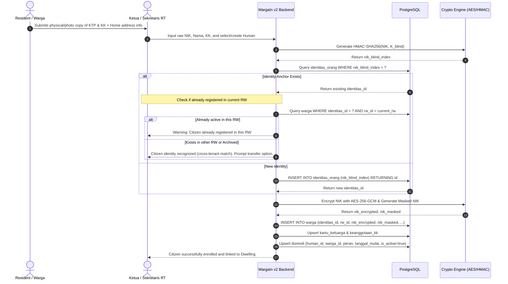
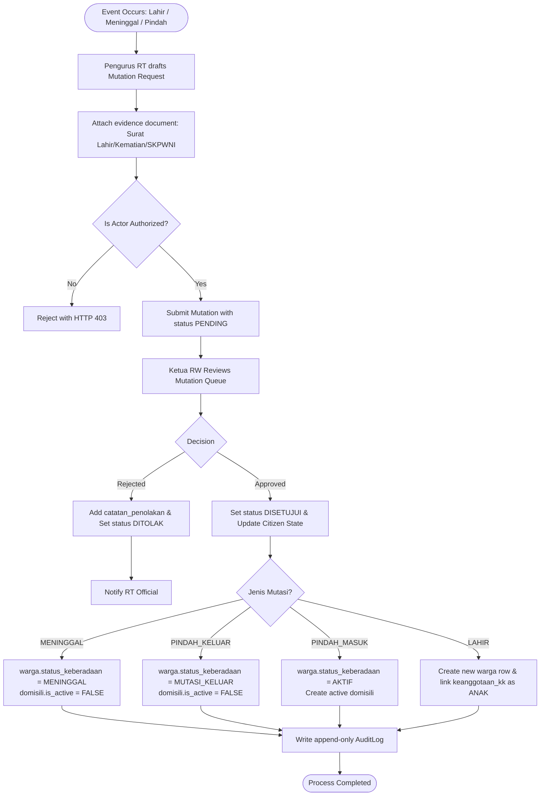
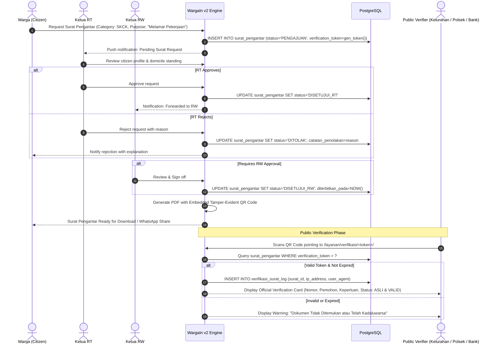
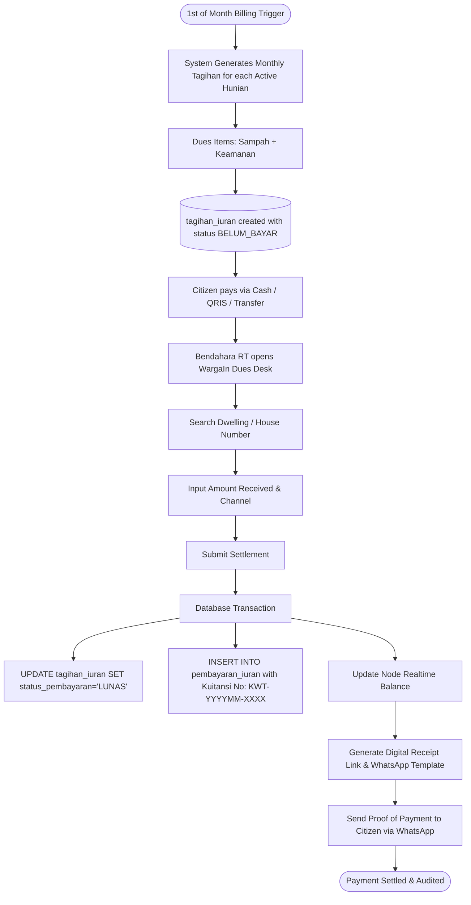
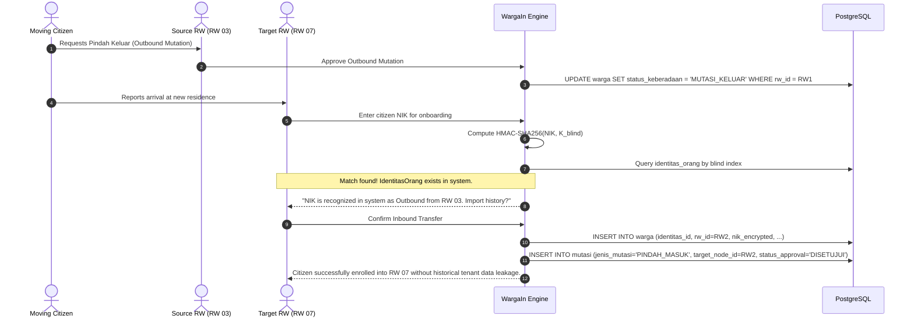

# WargaIn v2 — Business Process Specifications
**Document Identifier:** DOC-SPEC-03-BPMN  
**Standard Compliance:** BPMN 2.0 (Business Process Model and Notation) & ISO/IEC 19510  
**Status:** Approved for Implementation  
**Audience:** System Architects, Developers, RT/RW Administrators, Quality Assurance Engineers

---

## 1. Scope & Architecture Context

This document specifies the end-to-end operational workflows of WargaIn v2. The processes are designed specifically for Indonesian community governance (Rukun Tetangga / Rukun Warga) and strictly adhere to:
1. **Tri-Axial Relational Isolation**: Differentiating physical inhabitant status from civil registry documentation.
2. **Maker-Checker Governance**: Two-tier verification (Warga $\to$ Ketua RT $\to$ Ketua RW) ensuring grass-roots transparency without administrative overhead.
3. **UU PDP No. 27/2022 Compliance**: Minimizing personal data exposure during cross-boundary interactions and public verifications.

---

## 2. Business Process Catalog

| Process ID | Name | Primary Actor | Trigger Event | Output Artifact |
| :--- | :--- | :--- | :--- | :--- |
| **BP-01** | Tri-Axial Citizen & Domicile Onboarding | Ketua RT / Admin RW | New resident arrival / census | Active `Warga`, `Domisili`, and `KeanggotaanKK` |
| **BP-02** | Mutation Lifecycle (In/Out/Birth/Death) | Warga / RT Official | Vital civil event | Approved `Mutasi` record, status update |
| **BP-03** | Digital Surat Pengantar & QR Verification | Warga / RT / RW | Citizen request for official service | Digitally verifiable PDF/Web Certificate |
| **BP-04** | Dues Billing & Instant WhatsApp Receipting | Bendahara RT / Warga | Monthly billing cycle generation | Cashflow ledger entry & Digital Receipt URL |
| **BP-05** | Wilayah Node Claiming & RT Federation | Pengurus RW / RT | New neighborhood onboarding | Active `WilayahNode` branch & RBAC roles |
| **BP-06** | Zero-Knowledge Inter-RW Transfer | Pengurus RW (Source/Dest) | Outbound/Inbound migration | Cross-tenant cryptographic identity transfer |

---

## 3. Detailed Process Specifications

### BP-01: Tri-Axial Citizen & Domicile Onboarding

This process handles resident registration while preserving the separation between civil documents (KTP/KK) and local physical occupancy (Hunian).

#### Key Rules:
- A non-local resident (e.g., Mahasiswa / Pekerja Kos) is enrolled into `warga` and `domisili` with `peran_di_hunian = PENGHUNI_KOS`.
- If their family card is located in another province, they are not forced into an artificial local `kartu_keluarga`.

---

### BP-02: Population Mutation Lifecycle

Covers civil dynamics: Birth (*Lahir*), Death (*Meninggal*), Inbound Migration (*Pindah Masuk*), and Outbound Migration (*Pindah Keluar*).

---

### BP-03: Digital Surat Pengantar & Public QR Verification

Eliminates the physical friction of locating RT/RW leaders at home while retaining formal legal validity through digital verification tokens.

---

### BP-04: Periodic Dues (Iuran) Billing & Instant Digital Receipts

Eliminates loss of funds and manual bookkeeping errors through monthly dwelling-based invoices and automated WhatsApp receipts.

---

### BP-05: Wilayah Node Claiming & RT Federation

Governs the establishment of new RW and RT nodes within the national hierarchical tree.

1. **Hierarchy Registration**: An applicant (Ketua RW) creates an organizational node under the specific `Kelurahan`.
2. **Identity Verification**: The applicant submits SK Kepengurusan RW from the Kelurahan.
3. **Node Activation**: Platform admin verifies credentials and marks the RW node as `is_active = TRUE`.
4. **RT Sub-node Creation**: The RW administrator creates child nodes (`RT 01` through `RT 0n`) and invites Ketua RT via telephone/email token.
5. **Role Assignment**: RT officials receive restricted scoped permissions (read/write only within their own RT node and subordinate hunian).

---

### BP-06: Zero-Knowledge Inter-RW Citizen Transfer Protocol

Facilitates citizen relocation across participating RWs without leaking previous private logs or sensitive unmasked records.

---

## 4. Business Exception & Resilience Protocols

1. **Offline Collection Handling**: If RT treasurers collect cash during door-to-door rounds without internet connectivity, the system accepts batch entry timestamping with retro-active payment dates, preventing unfair late-marking.
2. **Stale Surat Requests**: Surat Pengantar requests in `PENGAJUAN` state exceeding 14 days without RT/RW action are automatically marked `KADALUWARSA` to avoid unbounded queues.
3. **Disputed Domicile Occupancy**: If two residents claim the same dwelling under conflicting roles, the RT administrator must execute a physical verification and override via the Domicile Management interface.
