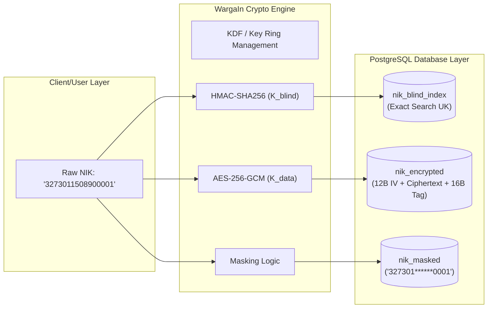

# WargaIn v2 — Security & Data Protection (UU PDP) Specification
**Document Identifier:** DOC-SPEC-04-PDP-SEC  
**Standard Compliance:** UU No. 27/2022 (Pelindungan Data Pribadi), ISO/IEC 27001:2022, NIST SP 800-57  
**Status:** Approved for Implementation  
**Audience:** Security Engineers, Lead Developers, Data Protection Officers (DPO)

---

## 1. Regulatory Context: Indonesian UU PDP No. 27/2022

Under Law of the Republic of Indonesia Number 27 of 2022 concerning Personal Data Protection (UU PDP), WargaIn v2 operates as a **Data Processor** and **Data Controller** in partnership with neighborhood institutions (Pengurus RT/RW). 

Civil identification numbers (NIK, Nomor KK) constitute **Specific Personal Data** (Data Pribadi Spesifik / Sensitif) pursuant to Article 4 paragraph (2) letter e, which carries strict civil and criminal liability for unlawful disclosure, unauthorized processing, or unencrypted storage.

---

## 2. Cryptographic Security Architecture



### 2.1. Blind Indexing Formula (Zero-Knowledge Search)
To allow RT/RW administrators to search for an individual by exact NIK without storing plaintext NIKs or enabling cross-database statistical leaks:

$$\text{Index}_{\text{blind}} = \text{HMAC-SHA256}(K_{\text{blind}}, \text{Clean}(\text{NIK}))$$

Where:
- $\text{Clean}(\text{NIK})$ strips non-numeric characters and ensures exact 16-digit ASCII representation.
- $K_{\text{blind}}$ is a 256-bit cryptographically secure key stored exclusively in application environment secrets (never persisted in the database).
- The resulting 64-character hexadecimal digest is indexed with a `UNIQUE` constraint on table `identitas_orang`.

### 2.2. Authenticated Symmetric Encryption (Data-at-Rest)
All raw PII fields (`nik_encrypted`, `nomor_kk_encrypted`) are secured via **AES-256-GCM** (Galois/Counter Mode):
- **Key Length**: 256 bits ($K_{\text{data}}$ derived via HKDF).
- **Initialization Vector (IV)**: 96-bit (12 bytes) cryptographically random nonce generated uniquely per encryption invocation.
- **Authentication Tag**: 128-bit (16 bytes) tag appended to ensure confidentiality and integrity.
- **Ciphertext Storage Format**:
  $$\text{Payload} = \text{IV (12B)} \mathbin{\Vert} \text{Ciphertext} \mathbin{\Vert} \text{Tag (16B)}$$

---

## 3. Masking & Display Rules

Unmasked sensitive data is strictly restricted from default UI rendering. System views render masked placeholders by default:

| Field Name | Raw Format Example | Masked Representation | Public Verification Display |
| :--- | :--- | :--- | :--- |
| **NIK** | `3273011508900001` | `327301******0001` | `3273**********01` |
| **Nomor KK** | `3273012010150005` | `327301******0005` | *Hidden completely* |
| **No. Telepon** | `081234567890` | `0812****7890` | *Hidden completely* |
| **Tanggal Lahir**| `1990-08-15` | `15/08/1990` | `**/**/1990` |

---

## 4. Multi-Tenant Row-Level Isolation (RW Scoping)

Every query executing within the administrative context is forced to bind against the active tenant boundary:

```sql
-- Enforcement pattern within Django ORM QuerySets
SELECT * FROM kependudukan_warga 
WHERE rw_id = :authenticated_user_rw_id 
  AND status_keberadaan = 'AKTIF';
```

- Superusers or higher-tier officials (Kelurahan/Kecamatan) **cannot** view raw list tables of citizen rows in an RW.
- Higher tiers access only **pre-aggregated demographic summaries**.

---

## 5. Small-Cell Suppression Rule ($N < 5$)

To prevent re-identification through demographic deduction in small RT environments:

$$\text{Displayed Metric} = \begin{cases} 
\text{Count}, & \text{if } \text{Count} \ge 5 \text{ or } \text{Count} = 0 \\
\text{"< 5 (Disamarkan)"}, & \text{if } 1 \le \text{Count} < 5 
\end{cases}$$

Example:
- If RT 03 has 2 citizens registered with a specific rare religion or chronic health condition, public and higher-level rollups suppress this exact number to prevent neighbor identification.

---

## 6. Read-Access Logging (Auditing Raw PII Views)

Pursuant to Article 31 of UU PDP, all access to unmasked specific personal data must be permanently logged:

```json
{
  "event_type": "READ_PII_UNMASK",
  "timestamp": "2026-10-31T17:05:00.123Z",
  "actor_user_id": "8f3e2b1a-...",
  "actor_role": "KETUA_RT",
  "warga_id": "4b2e8d19-...",
  "field_accessed": "nik_encrypted",
  "reason": "Verifikasi Surat Pengantar SKCK No. 045/RT03/IX/2026",
  "client_ip": "180.252.164.21",
  "user_agent": "Mozilla/5.0 (Windows NT 10.0; Win64; x64) Chrome/130.0.0.0"
}
```

The `audit_log` table is configured as **INSERT ONLY**:
- `UPDATE` and `DELETE` privileges are explicitly revoked for standard database application users (`REVOKE UPDATE, DELETE ON audit_log FROM wargain_app`).
- Logs are retained for a minimum statutory period of 5 years.
